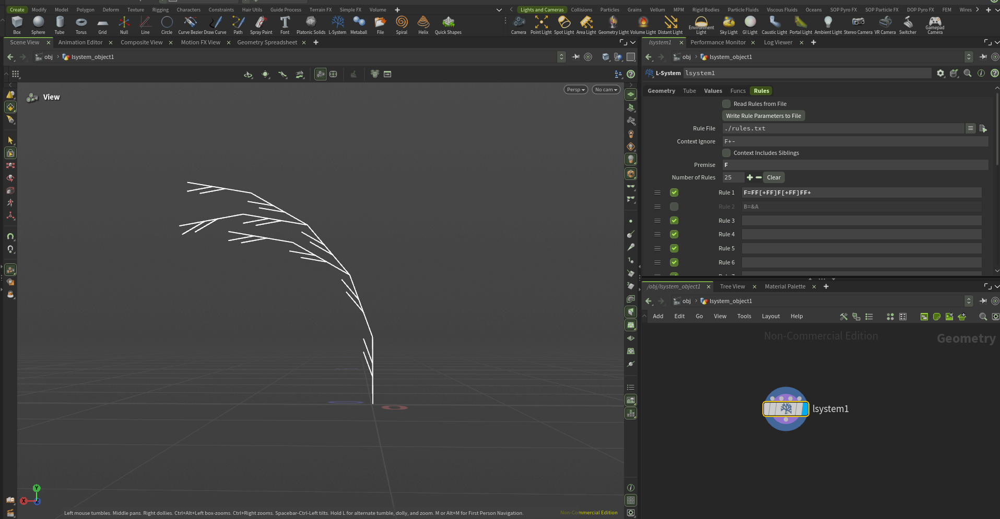
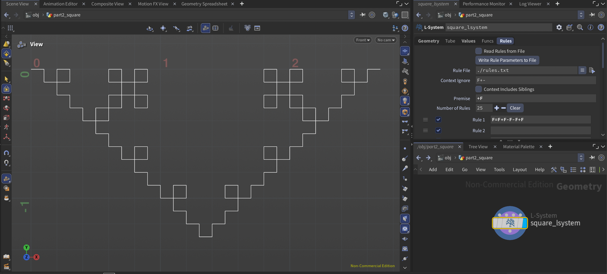
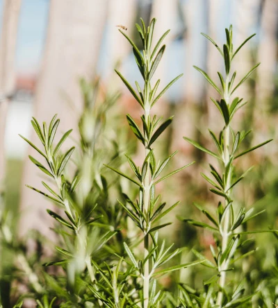
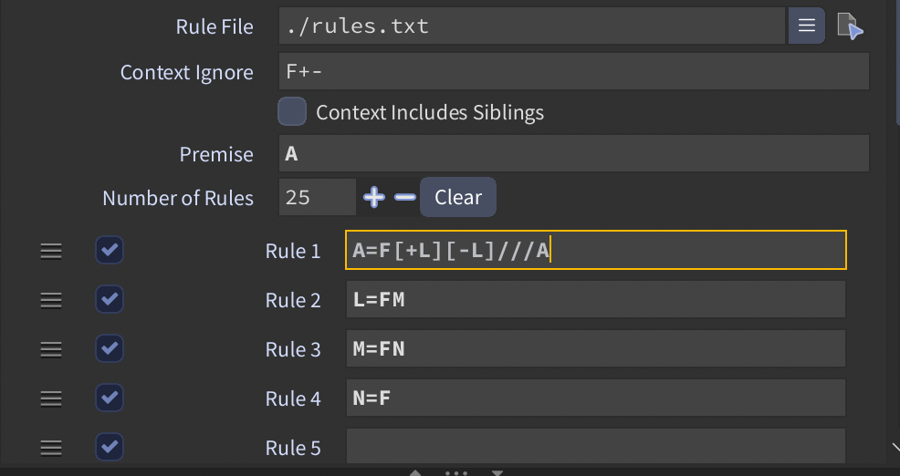
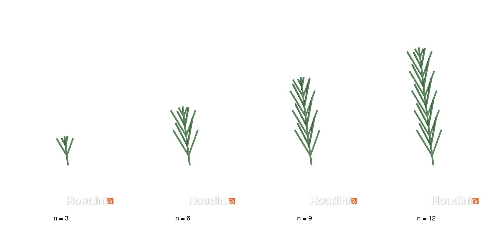
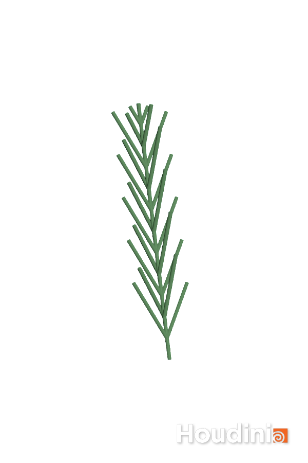

# lab05-grammars
Let's practice using grammars! For this lab, please pull up the L-system node in Houdini.

## 1. Wheat grammar puzzle
Look at these iterations (n = 1, 2, 3) of a one-rule grammar. Using the built in symbols in Houdini, design a grammar that produces this output. Take a screenshot of your rules.\

## 2. Square grammar puzzle
How about this one? Take a screenshot of your rules.\

## 3. Custom plant

Choose a plant in the world. Working off a reference, design a grammar that mimics the structure of that plant. Unlike our simple puzzles, please use multiple rules for greater complexity. Think carefully about the structure of your grammar! EXPLAIN the structure of your plant in the README. What are the components? What do each of the rules do? Be sure to also include images of a few iterations of your output plant. 

### My plant: Rosemary (*Salvia rosmarinus*)

The model is a single rosemary stem: a straight main stem with pairs of narrow needle leaves pointing upward. Each leaf pair is turned 90° from the pair below it, so the leaves stick out in all directions. New leaves appear at the tip and get longer as they age, so the top of the stem tapers to a point. The L-system is drawn as green tubes (Type = Tube, followed by a Color node).

#### Components

- **Stem:** the `F` segments along the main axis.
- **Leaf pairs:** `[+L][-L]` puts one leaf on each side of the stem.
- **Roll:** `///` rolls the turtle 3 × 30° = 90° so that the next leaf pair faces a different direction.
- **Growing tip:** `A`, which adds a new node at the top every generation.

#### Grammar (Angle = 30°, Generations = 12)

Premise: `A`

| Rule | What it does |
| --- | --- |
| `A=F[+L][-L]///A` | The tip adds a stem segment and a pair of leaves, rolls 90°, then keeps growing upward. |
| `L=FM` | A new leaf grows its first segment. |
| `M=FN` | The leaf grows its second segment. |
| `N=F` | The leaf grows its third and final segment, then stops growing. |

Each leaf grows one segment per generation for three generations. As a result, the newest leaves near the tip are short and the older leaves below are full length, which gives the pointed tip.

#### Iterations

Final result (n = 12):

## Submission
- Create a pull request against this repository
- In your readme, list your solutions and format your README nicely
- Profit
